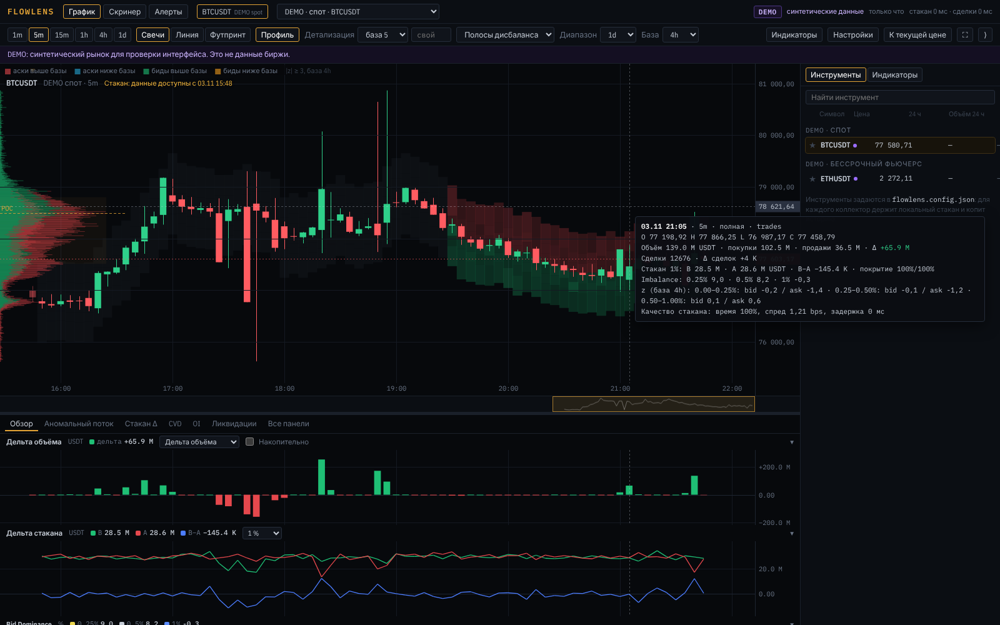
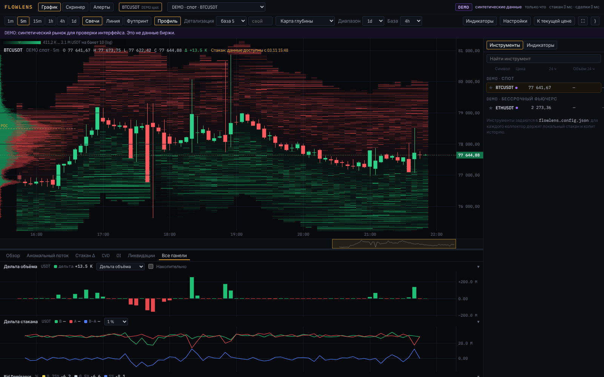
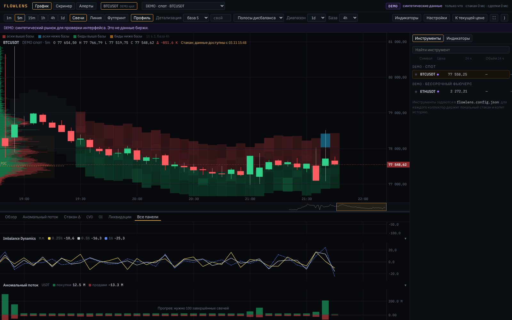

# FlowLens

Веб-терминал анализа криптовалютного рынка: цена, история стакана, поток
исполненных сделок и индикаторы дисбаланса в одном интерфейсе. Данные —
публичные API Binance (spot и USD-M perpetual) и Bybit (spot и linear),
без ключей и торговых разрешений.



| Карта глубины | Панели индикаторов |
|---|---|
|  |  |

Скриншоты сделаны в DEMO-режиме на синтетическом рынке. Это не данные биржи.

## Быстрый старт

Нужен Python 3.10+. Node.js не нужен: собранный интерфейс лежит в
`backend/flowlens/static`.

**Linux / macOS**

```bash
./run.sh            # живые данные Binance и Bybit
./run.sh --demo     # синтетический DEMO-рынок, без интернета к биржам
```

**Windows**

```bat
run.bat
run.bat --demo
```

Затем откройте <http://127.0.0.1:8000>.

Скрипт создаёт `backend/.venv`, ставит единственную зависимость (`aiohttp`)
и запускает `python -m flowlens serve`. Вручную:

```bash
cd backend
pip install -r requirements.txt
python -m flowlens serve            # или: python -m flowlens serve --demo --port 8001
```

**Docker**

```bash
docker compose up -d                      # живые данные: http://127.0.0.1:8000
docker compose --profile demo up -d       # DEMO:          http://127.0.0.1:8001
```

Данные лежат в томе `flowlens-data`. Свою конфигурацию положите в
`config/flowlens.config.json` (образец — `config/flowlens.config.example.json`).

### Что будет при первом запуске

* Свечи с разбивкой покупок/продаж за последние 3 дня подтягиваются из
  свечей Binance сразу (у Bybit в свечах нет такой разбивки, поэтому дельта
  Bybit появляется только с момента запуска).
* **История стакана копится с момента запуска.** Биржи не отдают прошлый
  стакан, а из свечей его не восстановить. График пишет «Стакан: данные
  доступны с …». Чем дольше работает коллектор, тем длиннее история
  (хранится 14 дней, настраивается).
* Z-score и цвет полос дисбаланса считаются после прогрева базы (по
  умолчанию 1 сутки; для коротких тестов выберите базу 1h или 4h).
* DEMO генерирует 6 часов синтетической истории (~45 с) и всегда помечен
  DEMO в шапке и на графике.

## Конфигурация

Порядок: значения по умолчанию → JSON-файл (`FLOWLENS_CONFIG` или
`./flowlens.config.json`) → переменные окружения `FLOWLENS_<ИМЯ>`
(например `FLOWLENS_PORT=8080`, `FLOWLENS_RETENTION_DAYS=30`).

| Параметр | По умолчанию | Смысл |
|---|---|---|
| `instruments` | BTCUSDT, ETHUSDT spot Binance; BTCUSDT perp Binance; BTCUSDT spot и perp Bybit | для каждого коллектор держит локальный стакан |
| `instruments[].depth` | Binance spot 5000, USD-M 1000, Bybit spot 200, linear 500 | глубина снимка / top-N потока |
| `instruments[].heatmap_step`, `footprint_step` | ~1 и ~0.5 б.п. цены (BTC: 10 и 5 USDT) | шаг хранения карты и футпринта |
| `heatmap_range_pct` | 3.0 | диапазон карты глубины вокруг mid, ±% |
| `kline_backfill_days` | 3 | свечи из истории биржи при старте |
| `retention_days` | 14 | срок хранения агрегатов |
| `record_raw`, `raw_retention_hours` | false, 6 | запись сырых сообщений для воспроизведения |
| `host`, `port`, `db_path` | 127.0.0.1, 8000, data/flowlens.db | сервер и база |
| `binance_*`, `bybit_*` | официальные адреса | можно перенаправить, например на тестовую биржу |

Секретов в конфигурации нет. Токен Telegram вводится в интерфейсе и
хранится только в локальной базе.

## Интерфейс

* **Верхняя панель:** разделы (график, скринер, алерты), вкладки открытых
  графиков, выбор инструмента (биржа · рынок · символ), статус LIVE /
  CONNECTING / STALE / RESYNC / DEMO / ERROR, время последнего события и
  задержка данных (получение − время биржи).
* **Панель графика:** таймфреймы 1m…1d (5m по умолчанию), свечи / линия /
  футпринт, профиль объёма, метрика футпринта (объём, дельта, продажи×покупки,
  сделки, дельта сделок), детализация (10/20/50 USDT для BTC или свой шаг),
  слой стакана (полосы дисбаланса / карта глубины / без слоя), диапазон
  1d–14d или свой, база статистики 1h–14d, «Индикаторы», «Настройки»,
  «К текущей цене», полноэкранный режим.
* **График:** общая шкала времени и синхронное перекрестие с панелями;
  колесо — масштаб, перетаскивание — история (автопрокрутка выключается),
  перетаскивание по шкале цены — вертикальный масштаб, двойной клик по ней —
  сброс. Профиль слева, маркер последней цены справа, миникарта истории снизу,
  треугольники сверху — начало новой достоверной последовательности стакана.
  Подсказка: время, OHLC, объём, покупки/продажи/дельта, сделки, стакан 1 %,
  дисбаланс, z-score поясов, качество данных (покрытие, спред, задержка).
* **Нижние панели:** вкладки «Обзор», «Аномальный поток», «Стакан Δ», «CVD»,
  «OI», «Ликвидации», «Все панели»; высота меняется перетаскиванием, панель
  сворачивается кликом по заголовку.
* **Правая колонка** (сворачивается): поиск, избранное, группировка по бирже
  и рынку, цена, изменение и объём за 24 ч с единицей; менеджер индикаторов —
  включение, порядок, настройки, удаление.
* **Телефон:** график на всю ширину, параметры графика в выдвижной панели,
  инструменты и индикаторы — в отдельной выдвижной панели, панели
  индикаторов сворачиваются.

## Источники данных и ограничения

| | Binance Spot | Binance USD-M | Bybit spot / linear |
|---|---|---|---|
| Стакан | WS `depth@100ms` + REST снимок 5000 | WS `depth@100ms` (маршрут `/public`) + снимок 1000 | WS `orderbook.200` / `orderbook.500` (top-N) |
| Синхронизация | U/u по документации spot | `pu` = предыдущий `u` по документации USD-M | snapshot сбрасывает, delta применяется; скачки `u` учитываются в метриках |
| Сделки | `aggTrade`, агрессор по `m`, id подряд → дозагрузка пропусков по REST | то же, маршрут `/market` | `publicTrade`, сторона тейкера `S`, id-строки |
| История свечей | `klines` с объёмом тейкер-покупок | то же | `kline` без разбивки → buy/sell = null |
| OI / funding / ликвидации | неприменимо | REST `openInterest` + история 5 мин, `markPrice@1s`, `fundingRate`, `forceOrder` | `tickers`, история OI и funding, `liquidation` |

Важно:

* **Покрытие глубины.** Снимок Binance Spot (5000 уровней) не всегда
  достаёт до 1 % у BTC, top-N Bybit (200/500 уровней) обычно не достаёт.
  Полоса без полного покрытия выдаётся как `null` с долей покрытия, а не как
  заниженное число. Глубины 3/5/10 % видны только при достаточном покрытии.
* **Разрыв последовательности** → книга помечается недействительной, статус
  RESYNC, новый снимок; начало новой последовательности отмечается на графике
  и в журнале качества. Индикаторы на неполном стакане не считаются.
* **Ликвидации Binance** (`forceOrder`) — не более одной в секунду на символ:
  поток неполный, в панели есть пометка.
* **Маршруты WS Binance USD-M** (`/public`, `/market`) взяты из уведомления
  Binance об обновлении WebSocket (2026); официальную страницу из среды
  разработки открыть не удалось. Если поток «молчит», сторож тишины покажет
  STALE и переподключится; адреса меняются в конфигурации
  (`binance_perp_ws_public`, `binance_perp_ws_market`).
* Документация Binance Spot и Bybit v5 сверялась по официальным
  репозиториям на GitHub. Против живых бирж из среды разработки код не
  запускался (сетевой доступ к биржам закрыт): адаптеры проверены тестами
  на эмуляторе протоколов.
* Binance недоступен из некоторых стран (HTTP 451/403). Тогда используйте
  Bybit, VPN по правилам вашей юрисдикции или DEMO.

Формулы, единицы и все правила `null` — в [docs/FORMULAS.md](docs/FORMULAS.md).
Устройство, сущности и API — в [docs/ARCHITECTURE.md](docs/ARCHITECTURE.md).

## Что реализовано

| Функция | Статус |
|---|---|
| График: свечи, линия, футпринт, профиль объёма с POC/VA, миникарта, синхронные панели | готово |
| Локальный стакан с синхронизацией по правилам каждой биржи, покрытие глубины, ресинхронизация | готово |
| Карта фактической глубины (среднее / максимум, лог-шкала с легендой, NaN вне покрытия) | готово |
| Полосы дисбаланса 0–0.25 / 0.25–0.5 / 0.5–1 % с цветом по z-score | готово (наша логика) |
| Дельта объёма, дельта сделок, CVD со сбросом, аномальный поток сделок | готово |
| Дельта стакана, Bid Dominance (Imbalance / Bid Share), Imbalance Dynamics + EMA | готово |
| Z-score с прогревом, покрытием и выбором базы | готово |
| RSI, MACD | готово |
| OI, funding, ликвидации (только perp) | готово |
| Binance spot и USD-M, Bybit spot и linear | готово, проверено на эмуляторе |
| Хранение истории (SQLite + миграции), запись сырых событий и воспроизведение | готово |
| Скринер с сортировкой, фильтрами и избранным | расширение, готово |
| Алерты с подтверждением, cooldown и журналом; Telegram | расширение, готово; отправка в Telegram не проверялась (нет сети) |
| DEMO-источник с постоянной маркировкой | готово |
| DMI, SMF, BGW и другие авторские модули референса | **недоступно**: нужна спецификация алгоритма; вместо BGW есть «Аномальный поток сделок» |
| Экспорт данных, массовое сканирование сотен символов | не реализовано |

## Расхождения с референсом

* Формулы полос, Bid Dominance, динамики и аномального потока — наша
  спецификация (docs/FORMULAS.md), а не алгоритмы референсных терминалов.
* Цвета полос: красный/зелёный — аски/биды, голубой/оранжевый — объём
  стороны статистически ниже базы (|z| ≥ 3). Подписи: «выше/ниже базы».
* Скринер считает только инструменты, для которых коллектор держит стакан
  (список в конфигурации), а не весь рынок.

## Тесты и проверка

```bash
cd backend
pip install -r requirements-dev.txt
python -m pytest -q
```

34 теста:

* формулы из раздела 10 ТЗ (B=150/A=100, Vbuy=12/Vsell=8, −10 % → 20 %),
  `null` при нулевом знаменателе, прогреве и неполной глубине;
* синхронизация: нормальный ход, старый снимок, разрыв, дубликаты,
  переставленные события, правило `pu`, сброс Bybit по snapshot и `u = 1`;
* воспроизведение записанных событий даёт те же агрегаты, прошлые точки не
  зависят от будущих событий;
* сквозной тест: коллектор + тестовая биржа с инъекцией сбоев (пропуск
  событий стакана, потеря и дубли сделок, обрыв соединения), затем API и
  WebSocket, включая переключение подписки; сквозной тест Bybit; алерты.

Нагрузочный прогон 1 и 10 инструментов — в [docs/LOADTEST.md](docs/LOADTEST.md).

### Разработка интерфейса

```bash
cd frontend
npm install
npm run dev        # http://localhost:5173, API проксируется на :8000
npm run build      # сборка в backend/flowlens/static
```

Прочее: `python -m flowlens mock-exchange --port 9100 --symbols BTCUSDT,ETHUSDT`
поднимает тестовую биржу; `python -m flowlens replay файлы.jsonl.gz
--fp-step 5 --heat-step 10` воспроизводит запись.

Прежняя одностраничная версия лежит в `legacy/orderflow.html`.

FlowLens — инструмент анализа рыночных данных. Он не даёт торговых
рекомендаций, а фильтры скринера и алерты не обещают прибыльных сделок.
