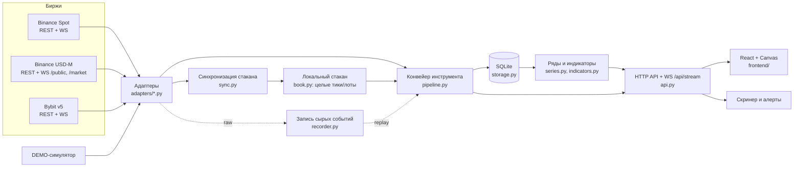

# Архитектура FlowLens

## Компоненты

| Модуль | Назначение |
|---|---|
| `numeric.py` | Точный разбор десятичных строк в целые с масштабом 1e8. |
| `book.py` | Локальный стакан (dict цена→количество), покрытие глубины, отсчёт полос и бакетов карты. |
| `sync.py` | Конечные автоматы синхронизации: `BinanceSpotSync` (U/u), `BinanceFuturesSync` (pu), `BybitSync` (snapshot/delta). Чистые: на вход сообщения, на выход действия (`need_snapshot`, `gap`, `synced`, `refreshed`). |
| `adapters/` | I/O: REST с учётом веса и `Retry-After`, переподключаемые WS со сторожем тишины, разбор сообщений конкретной биржи. |
| `pipeline.py` | Детерминированный конвейер инструмента: минутные свечи и футпринт из сделок, кадры стакана и карта глубины из отсчётов, деривативы. Время приходит только из входов. |
| `collector.py` | Тактовый генератор отсчётов (UTC-секунды), запись в БД каждые 2 с, статусы LIVE / CONNECTING / STALE / RESYNC / DEMO / ERROR, метрики. |
| `storage.py` + `migrations/` | SQLite в режиме WAL, версионированные миграции, чтение в пуле потоков. |
| `series.py`, `indicators.py` | Агрегирование минут в таймфрейм, все формулы (см. FORMULAS.md). |
| `api.py` | Маршруты FlowLens (не адреса бирж), live-поток для UI. |
| `screener.py`, `alerts.py` | Скринер и правила алертов (расширения), Telegram — опционально. |
| `recorder.py` | Запись сырых сообщений и воспроизведение. |
| `simulator.py`, `adapters/demo.py`, `mockexchange.py` | Синтетический рынок: DEMO-источник (всегда помечен DEMO) и тестовая биржа с инъекцией сбоев. |

## Сущности

| Сущность | Где | Поля |
|---|---|---|
| Instrument | `models.Instrument`, таблица `instruments` | exchange, market, symbol, base, quote, tickSize, quantityStep, contractSpec (+ шаги хранения в `meta`) |
| Trade | `models.Trade` | tradeId, seq, eventTime (exchange), receiveTime, price, quantity, aggressor, count, granularity (`raw`/`aggregate`) |
| BookEvent | сырые сообщения биржи (в `recorder`) | метаданные последовательности (U/u/pu или u/seq), время, стороны, цены, количества, признак снимка |
| BookSnapshot | REST-снимок / Bybit `snapshot` | lastUpdateId, уровни; покрытие — в `LocalBook` |
| Candle | таблица `candles_1m` | OHLC, объёмы buy/sell/unknown (кол-во и номинал), число сделок, источник, полнота |
| Кадр стакана | таблица `depth_1m` | mid, спред, задержка, `B_r`/`A_r` и покрытие по полосам, время отсчётов, граница новой последовательности |
| Карта глубины | таблица `heatmap_1m` | бакеты: среднее и максимум бидов/асков |
| Футпринт | таблица `footprint_1m` | бакеты: buy/sell количество и число сделок |
| IndicatorPoint | ответ `/api/indicators` | значения, `valid`/`status`, `params`, `params_hash`, `algorithm` |
| Workspace, AlertRule | таблицы `settings`, `alert_rules`, `alert_log` | настройки UI, правила, журнал |

## API сервера

| Маршрут | Ответ |
|---|---|
| `GET /api/meta` | версия, таймфреймы, базы, параметры по умолчанию |
| `GET /api/instruments` | инструменты, статус, шаги хранения, правила синхронизации |
| `GET /api/chart?inst&tf&from&to&params` | свечи + стакан + все индикаторы + доступность истории + события качества |
| `GET /api/candles`, `/api/depth-history`, `/api/indicators` | те же данные по частям |
| `GET /api/heatmap?inst&tf&from&agg=mean\|max&step` | карта глубины, float32 base64, `NaN` = нет покрытия |
| `GET /api/footprint?inst&tf&from&to&step` | футпринт по свечам |
| `GET /api/profile?inst&from&to&step&va` | профиль, POC, VAH/VAL |
| `GET /api/screener` | метрики скринера |
| `GET /api/health` | задержка такта, время записи, память, REST-вес, статусы синхронизации |
| `GET/PUT /api/settings/{key}` | рабочее пространство UI |
| `GET/POST/PATCH/DELETE /api/alerts`, `GET /api/alerts/log` | алерты и журнал |
| `GET/PUT /api/telegram`, `POST /api/telegram/test` | настройка доставки |
| `WS /api/stream` | `{"op":"sub","inst","tf"}` → `live` 4 раза/с, `bar_closed`, `statuses` |

У каждого ответа с данными есть единицы, источник, диапазон времени, валидность
и версия алгоритма.

## Скорость и ресурсы

* Частота поступления отделена от отрисовки: все события применяются к книге
  сразу, отсчёты — раз в секунду, UI получает агрегаты 4 раза в секунду.
* Выбор инструмента в UI заменяет подписку на сервере (одна на соединение).
* История загружается за выбранный диапазон, рисуются только видимые свечи;
  карта глубины рисуется одним `drawImage` из закадрового холста (пиксель =
  ячейка), без DOM-элементов на ячейку; ответ карты ограничен 2.5 млн ячеек
  (шаг цены укрупняется автоматически).
* Буфер событий на время ресинхронизации ограничен (20 000), переполнение
  учитывается в метриках; книга подрезается за пределами известного диапазона.

## Решения и отклонения от предложенной архитектуры

* **SQLite вместо PostgreSQL.** Для одного пользователя на одной машине база
  без отдельного сервера проще в установке. Объём измерен (см. LOADTEST.md):
  ~10 МБ в сутки на инструмент. Хранилище изолировано в `storage.py`; перенос
  на PostgreSQL/TimescaleDB — замена этого модуля.
* **Свой Canvas-движок вместо библиотеки графиков.** Нужны пользовательские
  слои (карта глубины, полосы, футпринт, профиль) в точных координатах и
  синхронные панели. Lightweight Charts поддерживает плагины, но футпринт и
  тепловую карту пришлось бы писать самим; свой движок проще контролировать.
* **Redis не используется** — один процесс, доставка обновлений через WS.
* Сырые события по умолчанию не пишутся (десятки ГБ в сутки на BTC); включаются
  `record_raw: true` с ограничением хранения в часах.
